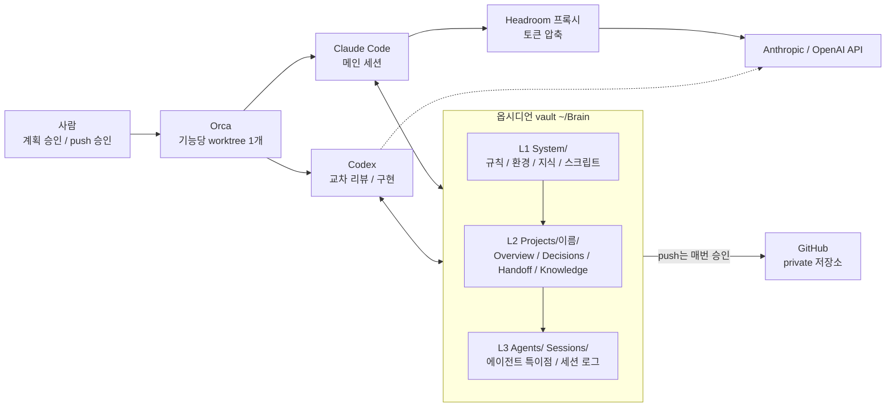
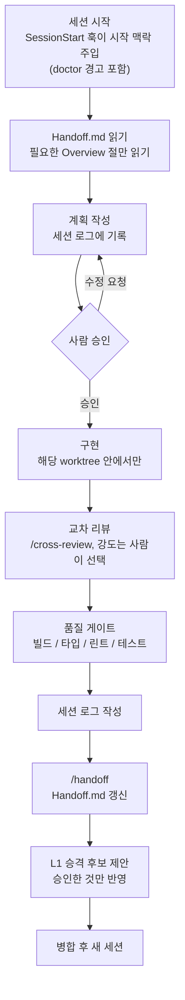
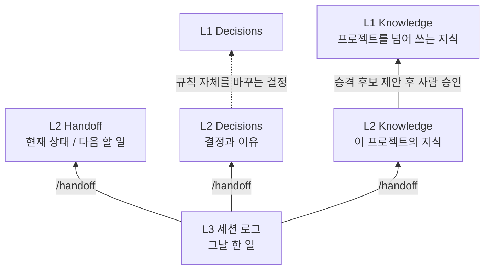

# 브레인(Brain) 하네스

사람과 AI 에이전트(Claude Code, Codex)가 같은 규칙과 같은 기억 위에서 일하도록 만든 **옵시디언 vault 기반 작업 하네스**다.
규칙은 계층으로 상속되고, 기억은 노트 사이의 링크로 연결되며, 되돌리기 어려운 일은 사람 승인 뒤에만 한다.

- 사용법: [docs/guide.md](docs/guide.md) (최소조건, 하루 흐름, 명령, 문제 해결)
- 설치: [docs/setup.md](docs/setup.md)
- 구성도: [System/diagrams/brain-harness.html](System/diagrams/brain-harness.html) (인터랙티브, 아래 5절)
- 문서 목차: [docs/README.md](docs/README.md)

## 1. 왜 만드는가

에이전트로 여러 프로젝트를 오래 진행하면 같은 문제가 반복된다. 저장소의 결정 기록과 로드맵에서 확인되는 것은 아래와 같다.

| 문제 | 하네스의 답 | 근거 |
|---|---|---|
| 프로젝트마다 하네스를 새로 만들면 규칙이 흩어지고 개선이 전파되지 않는다 | L1 전역 → L2 프로젝트 → L3 에이전트·세션 계층. 아래는 위를 상속한다 | [System/Decisions](System/Decisions.md) 2026-09-25 하네스 트리 구조 |
| 세션을 시작할 때 읽는 양이 많고, Handoff가 변경 이력이 되어 세션 로그·Decisions와 내용이 겹쳤다 (intra-tnm 기준 약 51KB) | 문서마다 역할 하나·길이 상한, 색인 방식 시작 맥락 | System/Decisions 2026-10-18 로드맵 2단계, [docs/stage2-record-structure.md](docs/stage2-record-structure.md) |
| 같은 확인 설명을 반복해 한 세션에서 50번 넘게 막혔고, 압축된 출력이 잘려 명령을 다시 실행했다 | GateGuard 예외, 모델 배치, 세션 길이 관리 | System/Decisions 2026-10-17 로드맵 1단계 |
| 요금제 사용량 안에서 써야 하는데 모델 전환을 사람이 매번 신경 쓰기 어렵다 | 상태줄이 사용량을 기록하고, 80% 이상이면 경고를 넣어 하향을 먼저 제안 | System/Decisions 2026-09-25 모델 자동 설정과 사용량 감시 |
| 하네스 설계 작업이 특정 프로젝트(intratnm)의 기록에 섞였다 | 하네스 자체를 L2 프로젝트 `brain-harness`로 분리 | System/Decisions 2026-10-17 분리 결정 |
| 여러 에이전트·worktree가 같은 기록을 동시에 덮어쓸 수 있다 | 세션 로그는 에이전트별 파일, Handoff는 `/handoff`로만 갱신 | [System/Rules](System/Rules.md) 2절 |

더 큰 방향(플랫폼 비전): 하네스를 단순한 프로젝트 지원용에서, 어떤 프로젝트든 L2로 올려 진행하고 그 경험을 지식으로 쌓아 발전하는
플랫폼으로 만든다. 초반에는 요구사항이 많겠지만 진짜 지식 축적은 다양한 프로젝트가 쌓이면서 이뤄진다
([Overview](Projects/brain-harness/Overview.md) 목적).

## 2. 설계 원칙

1. **옵시디언 vault가 기억의 기준**이다. ECC·Headroom 등 다른 도구의 기억과 다르면 vault가 우선한다.
2. **규칙은 계층으로 상속된다.** 충돌하면 가까운 계층이 우선한다 (L3 > L2 > L1).
3. **기억은 시냅스로 연결된다.** 노트 하나하나(`Overview.md`, `Decisions.md`, `Handoff.md`, `Rules.md`, `Sessions/` 로그)는 뉴런이고,
   노트 안에서 다른 노트를 가리키는 `[[위키링크]]`가 시냅스다. 프로젝트 `Overview.md`가 결정의 이유를 `Decisions`로 가리키고,
   세션 로그가 다시 `Decisions`를 가리키는 식이다. 기억이 따로 놀지 않고 연결돼 있어야 다음에 맥락을 잃지 않고 이어갈 수 있다.
   옵시디언 그래프 뷰를 열면 이 연결이 보인다. 다만 세션 시작 때 자동으로 들어가는 것은 `CLAUDE.md`의 `@` import와
   SessionStart 훅이 정한 노트뿐이고, 위키링크는 그 밖의 기억을 필요할 때 따라가 찾는 경로다.
4. **한 문서에 역할 하나, 한 사실은 한 곳에.** 문서별 길이 상한(세션 로그 40줄, Handoff 60줄, Decisions 항목 15줄, Knowledge 60줄)을 둔다.
5. **사람 승인 경계.** `git push`는 매번 사람 승인 뒤에만, L1(`System/`, `~/.claude`, `~/.codex`) 변경은 계획 → 확인 → 백업 → 변경 → 기록,
   실험은 격리 범위에서 시작 전 확인을 받은 뒤에만 한다.
6. **교차 리뷰.** 구현한 에이전트가 아닌 다른 에이전트가 diff를 본다 (Claude ↔ Codex). 강도는 사람이 고른다.
7. **자동 점검.** 상태 점검(`doctor.sh`), 커밋 전 차단(`precommit-check.sh`), 사용량 경고(`usage-check.sh`)를 스크립트로 둔다.
8. **사실을 지어내지 않는다.** 모르면 `TODO(확인 필요)`로 표시한다.

## 3. 설계 흐름도

### 3.1 구성



Codex는 Headroom을 거치지 않는다 (미적용, [Environment](System/Environment.md) Headroom 절).

### 3.2 세션 생명주기



### 3.3 기억 흐름



L1에 올린 뒤 L2에는 링크만 남긴다 (중복 금지).

## 4. 어떻게 쓰이는가

- **brain-harness (이 저장소 자체)**: 하네스를 만드는 프로젝트. 저장소가 vault이고, 로드맵과 진행 방식 결정은
  [Projects/brain-harness/](Projects/brain-harness/)에 기록한다. 규칙·설정 자체를 바꾸는 결정만 [System/Decisions](System/Decisions.md)에 쓴다.
- **intratnm**: 하네스를 **통해** 진행한 첫 프로젝트(회사 홈페이지, Next.js 기반). 코드는 별도 저장소에 있고, 저장소 루트의
  `.harness-project` 파일이 vault의 [Projects/intratnm/](Projects/intratnm/)와 연결한다 ([System/Projects](System/Projects.md)).
- 새 프로젝트는 Claude Code에서 `/new-project`로 시작한다. 템플릿([System/Templates/Project/](System/Templates/Project/))을 바탕으로
  L2·L3 구조와 저장소 연결 파일(`.harness-project`, `AGENTS.md`, `CLAUDE.md`)을 만든다.

일상 사용법(명령, 교차 리뷰 강도, 모델 선택, 문제 해결)은 [docs/guide.md](docs/guide.md)에 있다.

## 5. 구성도 (인터랙티브)

[System/diagrams/brain-harness.html](System/diagrams/brain-harness.html)은 외부 의존성 없이 단독 실행되는 HTML이다.
로컬에서 `open ~/Brain/System/diagrams/brain-harness.html`로 연다. GitHub 웹에서는 소스로만 보이므로 Raw로 내려받아 브라우저로 연다.
원본 명세는 `brain-harness.architecture.json`이고, 갱신법은 [diagrams/README.md](System/diagrams/README.md)에 있다.
구성도의 기준일은 2026-10-18이므로 그 뒤 변경은 반영 안 됐을 수 있고, 규칙 원문은 [Rules](System/Rules.md)가 맞다.

## 6. 어떻게 발전하는가

### 로드맵 ([Overview](Projects/brain-harness/Overview.md))
| 단계 | 내용 | 상태 |
|---|---|---|
| 1 | 비용·마찰 줄이기 (GateGuard 예외, 모델 배치, 세션 길이) | 완료 (2026-10-17) |
| 2 | 기록 구조 단순화 (역할·상한, 템플릿 4종, 색인) | 완료 (2026-10-18) |
| 3 | 플랫폼 기반: ① 자동 점검 → ② 유지보수 체계 → ③ 비용 기록 → ④ 자율성 기준표 → ⑤ 규칙 등록 절차 | 진행 중 (① 완료) |
| 4 | 지식 축적: L1 후보함, 정기 일괄 승인 | 예정 |
| 5 | 프로젝트 종류별 팩 (개발, 연구·설계, 보안 강화 등) | 예정 |
| 6 | 두 번째 프로젝트로 플랫폼 검증 | 예정 |

백로그: 6단계 후보 프로젝트 2개(블록체인 거래소 백엔드·커스터디·지갑, DID — 범위는 `TODO(확인 필요)`),
기능 확장 스킬(프로젝트를 하며 필요할 때 제작), 공개용 템플릿 분리.

### 진화 방식
- **정기 점검**: [Reviews](System/Reviews.md)의 주기마다 최신의 효율적이고 검증된 방법을 조사해 현재와 비교하고, 후보 목록(효과·비용·위험·적용 계층)을
  사람과 상의한 뒤에만 적용한다. 주기가 지나면 세션 시작 맥락에 알림이 뜬다.
- **실험 트랙**: 검증이 덜 된 도구도 격리 범위에서 시험할 수 있다. 시작 전에 목적·기간(기본 2주)·성공 기준·되돌리기 방법을 Decisions에 적고,
  끝나면 채택·각색·기각을 정한다. 기한이 지나도 결정이 없으면 되돌린다. 현재 brain-harness 범위로 실험 2개가 진행 중이다
  ([Handoff](Projects/brain-harness/Handoff.md)).
- **지식 올리기**: 세션 로그 → L2 → (승인 시) L1 Knowledge. 자동 학습 훅은 끈 채로, 자동 수집은 vault 안·격리 범위에서만 허용하고 반영은 사람이 승인한다.
- **공개용 템플릿 분리(계획)**: 개인 기록(Projects/·Sessions·이 PC 경로)을 뺀 System/ 틀과 빈 Projects로 남에게 배포하는 안.
  민감 정보 점검을 포함해 별도 worktree에서 한다. 현재는 내 환경용 설치 단계만 만든다 (사용자 결정 2026-10-18).

## 7. 폴더 구조

```
System/                      L1 공통
  Rules.md                   최상위 규칙
  Environment.md             도구, 경로, 포트, 설정 파일 위치
  Decisions.md               전역 결정 기록
  Projects.md                프로젝트 목록과 상태
  Reviews.md                 정기 점검 주기와 기록
  Knowledge/                 프로젝트를 넘어 쓰는 지식
  Templates/Project/         새 프로젝트용 vault 틀 (/new-project가 사용)
  commands/  skills/         공통 명령·스킬 원본 (Claude 전용)
  scripts/                   훅·상태줄·점검 스크립트 (tests/ 에 회귀 시험)
  diagrams/                  브레인 구성도 (HTML + 원본 JSON)
Projects/<이름>/             L2 + L3
  Overview.md  Decisions.md  Handoff.md  Knowledge/         (L2)
  Agents/Claude.md  Agents/Codex.md  Sessions/              (L3)
docs/                        사람이 읽는 가이드·설계 문서와 목차
```

| 계층 | 위치 | 내용 |
|---|---|---|
| **L1** 전역 | `System/` | 시스템 구성, 환경 설정, 공통 규칙, 공통 지식 |
| **L2** 프로젝트 | `Projects/<이름>/` + 저장소 `AGENTS.md` | 프로젝트 고유 규칙·지식 |
| **L3** 에이전트·세션 | `Projects/<이름>/Agents/`, `Sessions/` | 에이전트별 특이점, 세션 작업 로그 |

새 규칙·지식은 "다른 프로젝트에도 쓰이나?"로 둘 곳을 정한다. 쓰이면 L1, 이 프로젝트만이면 L2, 특정 에이전트·세션만이면 L3.
Claude Code는 `~/.claude/CLAUDE.md`를 통해, Codex는 `~/.codex/AGENTS.md`와 각 프로젝트 `AGENTS.md`를 통해 규칙을 읽는다.
저장소 루트의 `.harness-project`(내용: `Projects/` 아래 프로젝트 이름 한 줄)가 그 저장소를 vault 프로젝트와 연결한다.
vault 자체도 하나의 프로젝트(`brain-harness`)라서, `System/`은 하네스의 내용이고 하네스를 만드는 작업 기록은 `Projects/brain-harness/`에 둔다.

## 8. 주요 문서

- [Rules](System/Rules.md) — 최상위 규칙 (트리, 기억 저장소, 워크플로우, 교차 리뷰, 모델 선택, 공통 코드 규칙)
- [Environment](System/Environment.md) — 도구·경로·포트 등 환경 설정
- [Decisions](System/Decisions.md) — 전역 결정 기록
- [Projects](System/Projects.md) — 프로젝트 목록과 상태
- [Reviews](System/Reviews.md) — 정기 점검 주기와 기록
- [Overview](Projects/brain-harness/Overview.md) — 하네스 로드맵과 백로그
- [docs/guide.md](docs/guide.md) — 사용자 가이드 · [docs/README.md](docs/README.md) — 문서 목차

## 9. 원격 저장소

`brain-harness` (private, `github.com/sectwo/brain-harness`). 세션 시작 때 자동으로 pull하지 않는다.
동기화는 사람이 `/brain-sync`를 실행했을 때만(fast-forward만) 한다. 커밋은 의미 있는 단위로 자유롭게 하되,
**`git push`는 매번 사람이 명시적으로 승인한 뒤에만** 한다 (`/brain-sync`도 push는 하지 않는다).
